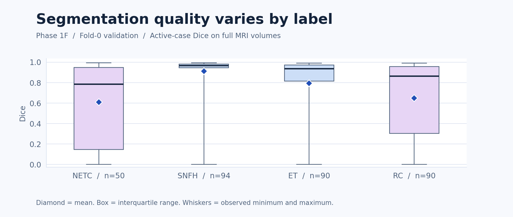
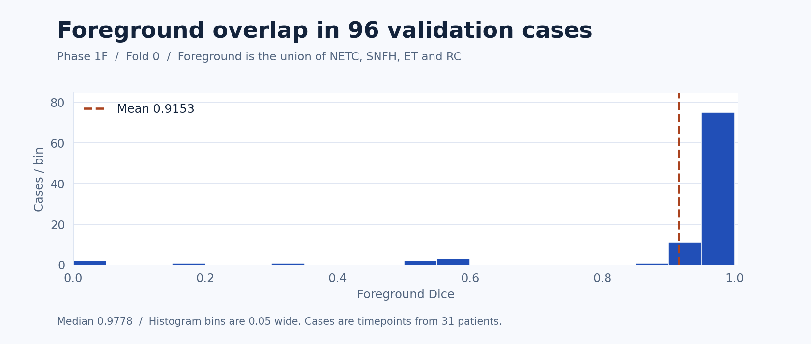
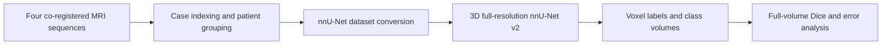
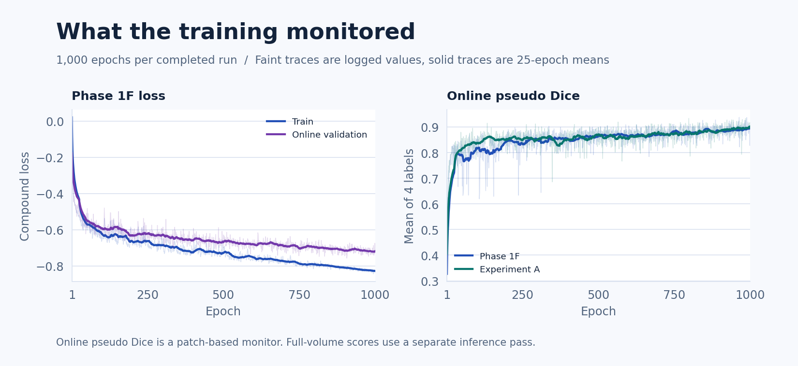
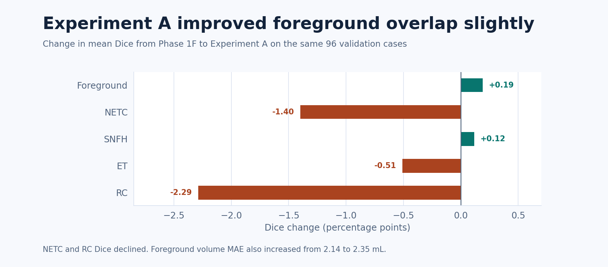

# Postoperative Glioma MRI Segmentation

A TEKNOFEST 2026 research project for segmenting four postoperative glioma MRI labels from four MRI sequences. The pipeline prepares data by patient, trains a 3D nnU-Net v2 baseline, and evaluates full-volume predictions. It also records a sampling ablation that tested whether more attention to small regions would improve segmentation.

[Read in Turkish](docs/README.tr.md) · [Reproduction guide](docs/reproducibility.md) · [Experiment notes](docs/experiments.md)

## Reference result

**Phase 1F reached 0.9153 mean foreground Dice across 96 validation timepoints from 31 patients in fold 0.** Foreground combines all four labels, including the resection cavity. The study measures agreement with reference masks on this validation fold. Independent test performance and clinical performance remain unestablished.



| Validation metric | Phase 1F | Experiment A |
| --- | ---: | ---: |
| Mean foreground Dice | 0.9153 | 0.9172 |
| Median foreground Dice | 0.9778 | 0.9777 |
| NETC active-case Dice | 0.6102 | 0.5962 |
| SNFH active-case Dice | 0.9108 | 0.9119 |
| ET active-case Dice | 0.7935 | 0.7884 |
| RC active-case Dice | 0.6494 | 0.6265 |
| Foreground volume MAE (mL) | 2.1400 | 2.3522 |
| WT volume MAE, excluding RC (mL) | 2.4477 | 2.7510 |

Both columns come from full-volume predictions with each run’s `checkpoint_best.pth` on the same 96 timepoints. An *active case* has the class in its reference mask or its prediction. This counts false-positive masks against the class score and excludes cases where both masks are empty. Each timepoint has equal weight in the means. [Aggregate results and provenance](results/README.md)



In 75 of 96 cases, foreground Dice was at least 0.95. Of those 75 cases, 27 still had at least one active label with Dice below 0.20. NETC and RC showed the widest spread, particularly for sub-millilitre regions.

## Data and label contract

The University of Missouri Post-operative Glioma Dataset (MU-Glioma-Post) provides skull-stripped, co-registered, resampled NIfTI images and expert-refined segmentation masks. The local inventory contained 203 patients and 596 timepoints. Two timepoints lacked a mask, leaving 594 usable cases. The model receives only the four image channels. Clinical and volume spreadsheets support local metadata audits. [TCIA data collection and license](https://www.cancerimagingarchive.net/collection/mu-glioma-post/) · [Data descriptor](https://doi.org/10.1038/s41597-025-06011-7)

The input channel order is **T1c** (contrast-enhanced T1), **T1n** (native T1), **T2w** (T2-weighted), and **T2-FLAIR**.

| Output label | Region |
| --- | --- |
| 0 | Background |
| 1 | NETC · non-enhancing tumour core |
| 2 | SNFH · surrounding non-enhancing FLAIR hyperintensity |
| 3 | ET · enhancing tissue |
| 4 | RC · resection cavity |

The `foreground` metric uses the union of labels 1–4. `WT` uses labels 1–3. All follow-up timepoints from a patient were assigned to one split. Fold 0 used 414 training timepoints from 142 patients and 96 validation timepoints from 31 patients. Another 84 timepoints from 30 patients were reserved in the split file.

## Architecture and training



The Phase 1F run used the six-stage `PlainConvUNet` with 32–320 channels, instance normalization, LeakyReLU and deep supervision. The recorded plan used masked per-channel Z-score normalization, 1 mm isotropic spacing, `128 × 128 × 128` training patches and batch size 2. The model trained for 1,000 epochs with soft Dice plus cross-entropy, SGD and polynomial learning-rate decay. The initial learning rate was 0.01 and momentum was 0.99. [Recorded settings](configs/phase1f.reference.yaml)



The right panel shows the mean of four logged per-label **online pseudo Dice** values at each epoch. The full-volume scores above come from a separate inference pass after training.

## Experiment development

The early prototype measured longitudinal volumes from existing masks. A binary 3D U-Net automated total-volume extraction. A custom multiclass U-Net added tissue-level measurements, and case-level analysis revealed persistent NETC and RC errors. Phase 1F established a standard nnU-Net v2 baseline. Experiment A kept the architecture and loss fixed and changed class selection for foreground patches. Experiment B added weighted cross-entropy and was stopped after epoch index 209. Its record contains training logs and no completed full-volume validation run. [Experiment notes and recorded decisions](docs/experiments.md)



**Phase 1F remains the reference.** Experiment A gained 0.19 percentage points of foreground Dice, while NETC and RC lost 1.40 and 2.29 points. The run also exceeded the configured 2.35 mL foreground volume MAE threshold. In the corrected sub-millilitre analysis, mean Dice for NETC fell from 0.4544 to 0.4415 across 23 reference-positive cases. RC improved from 0.3479 to 0.3607 across 24. The gains for small RC regions did not meet the experiment’s overall acceptance criteria.

## Engineering decisions

| Problem | Response |
| --- | --- |
| Repeated scans can leak patient information across splits | Normalize patient identifiers and assign all of a patient’s timepoints together. The recorded manifests had zero patient overlap. |
| Patch metrics can obscure full-volume errors | Run a separate full-volume inference pass, track both union and class Dice, and calculate volume error in mL. |
| Large regions dominate the aggregate score | Report per-label distributions and separate small reference-positive regions from absent cases. |
| Cloud notebooks and experiment archives are difficult to reuse | Preserve the source, parameterize the project path, strip saved notebook output, and derive the public figures from aggregate CSVs. |

## Setup and use

From the repository root, use Python 3.12 to install the preparation and plotting dependencies. The following commands exercise the data-free evaluator contract and rebuild all four figures.

```bash
python -m venv .venv
source .venv/bin/activate
python -m pip install -r requirements.txt
python -m src.eval.eval_contract --format text
python scripts/plot_results.py
```

Windows PowerShell activation is `.venv\Scripts\Activate.ps1`. Local MRI processing requires a separately downloaded copy of the TCIA dataset. Training and checkpoint inference require a compatible PyTorch/nnU-Net v2 environment. The recorded notebooks use Linux tooling, and the original nnU-Net version was not recorded. No model weights or patient files are included. The reproduction guide provides the local layout, preparation commands, and notebook entry points. [Reproduction guide](docs/reproducibility.md)

## Limitations

- The reported results cover fold-0 validation on one retrospective cohort. The historical nnU-Net fingerprint and plan used all 594 converted cases, including the reserved split. The optimizer’s recorded split excludes those cases. The 30 reserved patients also appeared in the earlier custom-model test partition.
- Small NETC and RC regions remain difficult to delineate. A high foreground Dice can still coincide with large errors in component volume. Several follow-up timepoints can come from the same patient.
- The current model outputs voxel labels and class volumes. Treatment response prediction, tumour grading, and diagnosis are outside this evaluation.
- A fresh GPU training run and checkpoint inference are not part of this release verification. [Reproduction and verification status](docs/reproducibility.md)

## Acknowledgments and references

Developed as a TEKNOFEST 2026 project. The dataset and nnU-Net framework are third-party work.

- Yaseen et al. (2025). *University of Missouri Post-operative Glioma Dataset (MU-Glioma-Post)*, version 1. The Cancer Imaging Archive. CC BY 4.0. [Dataset citation and terms](https://doi.org/10.7937/7K9K-3C83)
- Mahmoud et al. (2025). *MU-Glioma Post: A comprehensive dataset of automated MR multi-sequence segmentation and clinical features*. Scientific Data 12, 1847. [Paper](https://doi.org/10.1038/s41597-025-06011-7)
- Isensee et al. (2021). *nnU-Net: a self-configuring method for deep learning-based biomedical image segmentation*. Nature Methods 18, 203–211. [Paper](https://doi.org/10.1038/s41592-020-01008-z)

The project’s software license is pending team approval.
