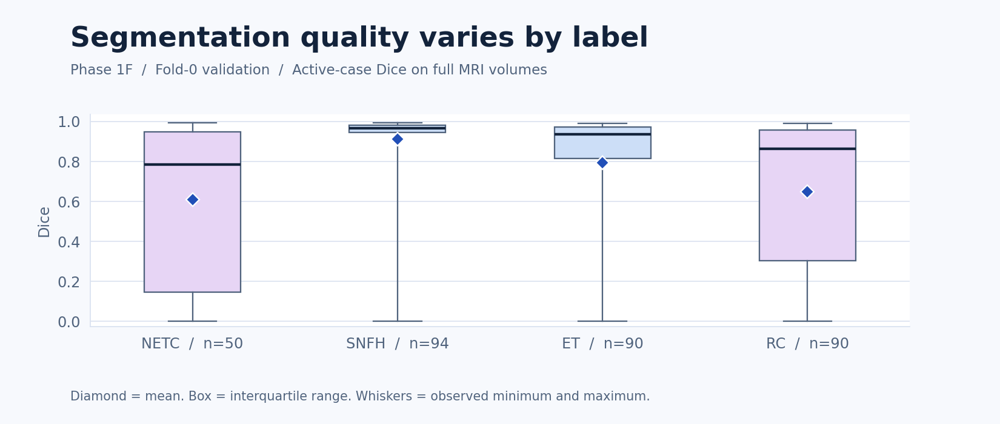

# Ameliyat sonrası glioma MR segmentasyonu

TEKNOFEST 2026 kapsamında geliştirilen bu araştırma projesi, dört MR modalitesinden ameliyat sonrası glioma bileşenlerini ve rezeksiyon boşluğunu 3B olarak segmentler. Girdiler T1c, T1n, T2w ve T2-FLAIR. Çıkışlar non-enhancing tümör çekirdeği (NETC), çevresel FLAIR hiperintensitesi (SNFH), kontrastlanan doku (ET) ve rezeksiyon boşluğu (RC) etiketleridir.

## Geliştirme durumu

Proje, eğitim ve tam hacim validasyonu tamamlanmış bir **araştırma prototipi** aşamasında. Nihai longitudinal takip sistemi, klinik doğrulama ve üretime alma açık hedefler.

- **Tamamlananlar:** Veri hazırlığı ve hasta bazlı ayırma, binary ve multiclass U-Net deneyleri, nnU-Net v2 Phase 1F eğitimi, 96 zaman noktasında validasyon, sınıf bazlı hata analizi ve Experiment A karşılaştırması.
- **Açık işler:** Bağımsız nihai test ve dış kohort değerlendirmesi, kalan deneysel iyileştirmeler, yeniden üretilebilir GPU ortamı ve longitudinal takip prototipinin tamamlanması.

## Doğrulanan sonuçlar

**Phase 1F fold-0 validasyonunda 31 hastadan 96 zaman noktası için ortalama foreground Dice 0,9153.** Foreground dört etiketin birleşimi. Sınıf Dice’ında referans veya tahminde etiketin bulunduğu vakalar hesaba katıldı. Tam hacim validasyonu, eğitimde izlenen patch tabanlı pseudo Dice’tan ayrı bir geçişte yapıldı.

| Ölçüm | Phase 1F | Experiment A |
| --- | ---: | ---: |
| Foreground Dice | 0,9153 | 0,9172 |
| NETC aktif vaka Dice | 0,6102 | 0,5962 |
| SNFH aktif vaka Dice | 0,9108 | 0,9119 |
| ET aktif vaka Dice | 0,7935 | 0,7884 |
| RC aktif vaka Dice | 0,6494 | 0,6265 |
| Foreground hacim MAE (mL) | 2,1400 | 2,3522 |

Experiment A sınıf odaklı patch örnekleme kullandı. Foreground Dice hafif yükselirken NETC ve RC Dice düştü. Hacim hatası karar eşiğini aştığı için Phase 1F referans olarak korundu. [Deney notları](experiments.md)

## Geliştirme ortamı ve teknik kısıtlar

Model eğitimlerinde **Google Colab** kullanıldı. Phase 1F kaydı **NVIDIA A100 40 GB** ve PyTorch `2.10.0+cu128` gösteriyor. Tam çözünürlüklü 3B MR eğitimi (`3d_fullres`) 128³ patch ve batch 2 ile bile saatler sürdü. Kesilen Phase 1F koşusu, checkpoint’ten 13. epoch indeksinde devam etti ve yaklaşık 18,6 saat sonra 1.000 epoch’u tamamladı. Kesintinin nedeni kayıtlarda belirtilmiyor. Colab oturum süresi, GPU erişimi ve bellek kapasitesi, gelecekteki koşuların planlama kısıtları. [Kayıtlı ayarlar](../configs/phase1f.reference.yaml) · [Yeniden üretim kılavuzu](reproducibility.md)

Experiment B, ağırlıklı çapraz entropinin hedef sınıflarda kalan hesaplama süresini karşılayacak tutarlı bir kazanım göstermemesi üzerine 209. epoch indeksinden sonra durduruldu. Tam hacim değerlendirmesi tamamlanmadı. Tarihsel nnU-Net sürümü kaydedilmedi ve GPU iş akışı yeni bir ortamda doğrulanmayı bekliyor. [Deney notları](experiments.md)

## Proje sınırları ve sonraki çalışmalar

- **Değerlendirme:** Yerel 596 zaman noktasının 594’ü gerekli görüntü ve maskeleri içeriyordu. Hasta bazlı bölmede hasta kesişimi yoktu. Planlayıcı ayrılmış 84 vaka dahil 594 vakanın tamamını gördü. Bu 84 vaka kayıtlı optimizasyon bölmesinin dışında kaldı ve ayrılmış 30 hasta önceki custom-model test bölümünde de yer aldı. Nihai değerlendirme için planlama yalnızca eğitim vakalarıyla yapılmalı ve daha önce kullanılmamış bir test kohortu ile dış veri seti değerlendirilmeli.
- **Segmentasyon:** Küçük NETC ve RC bölgelerinde toplam Dice, sınıf ve hacim hatalarını gizleyebiliyor. Sınıf bazlı tam hacim analizi bu farkı ortaya çıkardı. Kalan deneyler için sürümleri sabitlenmiş bir GPU ortamı ve uzun koşuları destekleyen altyapı gerekiyor.
- **Longitudinal takip:** Önceki zaman çizelgesi prototipi hazır maskelerden hacim çıkardı. Bir sonraki araştırma adımı seri çekimleri segmentasyon hattına bağlamak ve maske hatalarının hacim eğilimlerine nasıl yansıdığını ölçmek.

## Yerel kullanım

Python 3.12 ile `requirements.txt` dosyasındaki paketleri kurun. `python scripts/plot_results.py` mevcut toplu sonuçlardan grafikleri oluşturur. MR işlemek için TCIA’dan verinin yerel olarak edinilmesi gerekir. GPU eğitimi ve ağırlıkla inference için ayrıca uyumlu PyTorch/nnU-Net ortamı gerekir. Bu pakette görüntü, vaka düzeyi dosya ve checkpoint bulunmaz. [Kurulum ve deneyi yeniden üretme kılavuzu](reproducibility.md) · [İngilizce README ve atıflar](../README.md)
